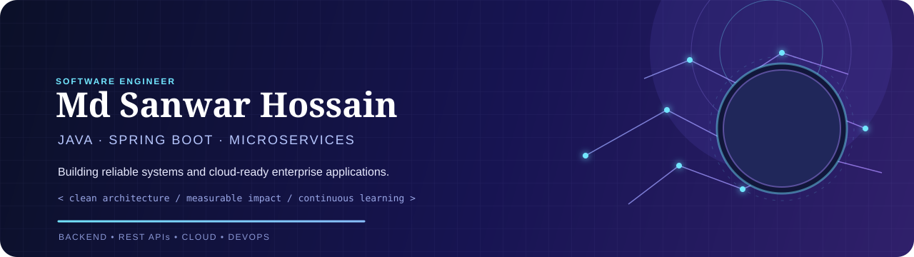

  

  
  
  
  

 

  
  

## About me

I am a software engineer focused on building **scalable, secure, and maintainable enterprise applications**. My core work is in Java and Spring Boot backend development, REST API design, microservices, and cloud-ready delivery.

- 🔭 Currently working on an **E-Procurement System**
- 🌱 Learning advanced **microservices, DevOps, CI/CD, and cloud engineering**
- 🤝 Open to **open-source, backend, and enterprise application collaborations**
- 🎓 BSSE student at **IIT, NSTU**
- ⚡ I enjoy turning complex engineering problems into simple, reliable solutions

## What I bring

<table>
  <tr>
    <td width="33%" align="center">🏗️ <strong>Reliable Architecture</strong> Maintainable services designed for growth</td>
    <td width="33%" align="center">⚙️ <strong>Engineering Discipline</strong> Clean code, testing, and automation</td>
    <td width="33%" align="center">📈 <strong>Business Impact</strong> Practical solutions that create value</td>
  </tr>
</table>

## Engineering focus

<table>
  <tr>
    <td width="33%" valign="top"><strong>Backend & APIs</strong> Java · Spring Boot · Grails REST · Microservices</td>
    <td width="33%" valign="top"><strong>Frontend</strong> Angular · React JavaScript · TypeScript · Tailwind CSS</td>
    <td width="33%" valign="top"><strong>Delivery & Data</strong> Docker · Jenkins · AWS MySQL · PostgreSQL · Redis</td>
  </tr>
</table>

## Technology toolkit

  

## GitHub activity

  
  

## Let's build something meaningful

Whether it is an enterprise platform, a cloud-native service, or an AI-assisted product, I am always interested in thoughtful engineering and useful collaboration.

  <a href="https://mdsanwarhossain.me"><strong>Explore my portfolio →</strong></a>

